# 🛡️ Awesome Autonomous AI Penetration Testing & Cyber Defense ⚔️

  

  
  
  
  
  
  

---

## 🚀 Overview & Ecosystem Scope

Welcome to the definitive curated index of **Autonomous AI Penetration Testing, Breach & Attack Simulation (BAS), Automated Red/Purple Teaming, and Continuous Threat Exposure Management (CTEM)**.

As offensive cyber operations and adversary tradecraft evolve, modern cybersecurity teams rely on **AI-driven autonomous penetration testing agents**, continuous security control validation engines, and automated adversary emulation frameworks. These solutions discover, map, exploit, and validate attack paths across cloud environments, web applications, on-premises internal networks, and Active Directory domains—without requiring months of manual penetration testing cycles.

Whether you are looking for production-grade enterprise SaaS platforms or cutting-edge open-source autonomous agents, this resource is organized for security engineers, CISOs, red team operators, and purple teamers.

---

## 📑 Table of Contents

- [📊 Sector Overview & Market Dynamics](#-sector-overview--market-dynamics)
- [☁️ SaaS & Hosted Platforms](#️-saas--hosted-platforms)
- [💻 Open-Source GitHub Projects](#-open-source-github-projects)
- [📈 Star History](#-star-history)
- [🤝 How to Contribute](#-how-to-contribute)
- [💖 Support & Sponsorship](#-support--sponsorship)
- [⚖️ Disclaimer](#️-disclaimer)

---

## 📊 Sector Overview & Market Dynamics

The global penetration testing and breach and attack simulation (BAS) market is valued at approximately **$3.8 billion to $4.0 billion combined** (with penetration testing at ~$2.74B growing at an 11.6%–15.3% CAGR, and BAS at ~$1.29B accelerating at a 22.8%–27.0% CAGR toward an estimated $13B+ combined footprint by the early 2030s). 

The sector is currently **moderately fragmented**—driven by rapid innovation in LLM-assisted autonomous exploitation and multi-vector agentic frameworks—with market share distributed between established vulnerability management giants and venture-backed category leaders like Horizon3.ai and Pentera rather than a single winner-take-all monopoly.

---

## ☁️ SaaS & Hosted Platforms

Enterprise platforms delivering automated penetration testing, continuous exposure management, and cloud-delivered red/purple teaming. Sorted in descending order by estimated company scale (valuation / annual revenue).

| 🏢 Platform | 📝 Description | 📈 Scale (Valuation / Revenue) | 💳 Starting Pricing | 🎁 Free Tier / Free Trial Limits |
| :--- | :--- | :--- | :--- | :--- |
| **[Horizon3.ai NodeZero](https://horizon3.ai)** | Autonomous penetration testing platform that continuously discovers attack paths, safely exploits vulnerabilities, and verifies remediation across internal, external, and cloud networks. | **$2B+ Valuation** (~$100M+ ARR, $428.5M funding) | ~$15 / asset / test (Flex episodic) or ~$18,600 / year (Core subscription) | 30-day proof-of-concept / evaluation trial upon request |
| **[Pentera](https://pentera.io)** | Automated security validation platform performing continuous, agentless real-world attack emulation across on-premise networks, cloud workloads, and identity infrastructure. | **$1B+ Valuation** (~$100M+ ARR, $160M funding) | ~$35,000 / year (Core / external attack surface base tier) | 14-day guided proof-of-concept / pilot assessment via sales engineering |
| **[HackerOne](https://hackerone.com)** | Leading crowdsourced security, bug bounty, and AI-assisted code/vulnerability discovery platform connecting organizations with global ethical hackers. | **~$450M–$800M Valuation** (~$75M+ revenue, $159M funding) | ~$20,000 / year (Vulnerability Disclosure / Bug Bounty platform access) | Free Community Edition for qualified open-source projects (unlimited reports) |
| **[NetSPI](https://netspi.com)** | Proactive enterprise security platform delivering Attack Surface Management (ASM), Penetration Testing as a Service (PTaaS), and Breach and Attack Simulation. | **~$500M+ Private Scale** (~$100M–$175M revenue, $500M KKR backing) | ~$7,000 / year (Attack Surface Management platform baseline) | Scoped live product demo & guided cloud PoC evaluation (no self-serve free tier) |
| **[Cymulate](https://cymulate.com)** | Cloud-based exposure management and continuous automated red teaming platform validating web gateways, email security, endpoints, and cloud attack surfaces. | **~$500M Valuation** (~$30M–$35M ARR, $141M funding) | ~$1,500 / feature / month or ~$7,000 / month (7-attack-vector bundle) | 14-day free trial covering core continuous assessment attack vectors |
| **[SafeBreach](https://safebreach.com)** | Enterprise Breach and Attack Simulation (BAS) platform executing thousands of continuously updated attack methods to validate endpoint, network, and cloud security controls. | **~$300M–$400M Valuation** (~$25M–$33M ARR, $106.5M funding) | ~$50,000 / year (SafeBreach Validate platform annual subscription) | 14 to 30-day scoped proof-of-concept evaluation (no self-serve free tier) |
| **[AttackIQ](https://attackiq.com)** | MITRE ATT&CK-aligned security optimization and Breach and Attack Simulation platform for testing defensive detection, SIEM/EDR rules, and incident response readiness. | **~$215M–$350M Valuation** (~$36M revenue, $76M funding) | ~$300 / test credit (Flex model) or ~$4,725 / unit / year (Enterprise Ready!) | 4-week proof-of-concept trial; free unlimited AttackIQ Academy training & certs |
| **[Picus Security](https://picussecurity.com)** | Continuous security validation and threat-centric exposure management platform pairing automated attack simulation with actionable SIEM/EDR/WAF mitigation signatures. | **~$150M–$250M Valuation** (~$44M revenue, $84M funding) | ~$20,000 / year (targeted deployment annual baseline) | 14-day free trial with simulation agents & mitigation insights |
| **[Cobalt.io](https://cobalt.io)** | Pentest as a Service (PtaaS) platform combining on-demand vetted security researchers with centralized vulnerability management, SLAs, and CI/CD integrations. | **~$120M–$200M Valuation** (~$35M–$51M ARR, $37.5M funding) | $3,500 / autonomous pentest or ~$1,800 - $2,500 / credit (8-hr unit blocks) | Scoped live product demo & guided assessment scoping (no self-serve free tier) |
| **[BreachLock](https://breachlock.com)** | Cloud-native Penetration Testing as a Service (PTaaS) platform uniting AI-assisted automated scanning with human-led red teaming and continuous retesting. | **~$50M–$80M Valuation** (~$17M–$20M ARR, $3.1M funding) | $2,500 one-time (Point-in-Time) or $5,000 / year (Annual Security Validation) | Live interactive product demo & scoped pilot assessment (no self-serve free tier) |

---

## 💻 Open-Source GitHub Projects

Curated open-source projects for autonomous offensive AI agents, vulnerability scanning engines, breach & attack simulation platforms, and purple team frameworks.

Repositories are **sorted in descending order by GitHub Stars_Count**. Each repository badge links directly to its stargazer community.

1. **[KeygraphHQ/shannon](https://github.com/KeygraphHQ/shannon)**   
   🤖 Fully autonomous open-source AI penetration testing agent that analyzes source code and live web applications in parallel to discover, exploit, and validate real vulnerabilities with reproducible proof-of-concepts.

2. **[rapid7/metasploit-framework](https://github.com/rapid7/metasploit-framework)**   
   🎯 The world's most widely used modular penetration testing framework providing automated exploit execution, payload generation, and post-exploitation validation.

3. **[projectdiscovery/nuclei](https://github.com/projectdiscovery/nuclei)**   
   ⚡ Fast, template-driven vulnerability scanner powered by a massive community-curated YAML engine for automated zero-day detection, CVE validation, and external exposure analysis.

4. **[wazuh/wazuh](https://github.com/wazuh/wazuh)**   
   🛡️ Unified open-source security monitoring, XDR, and SIEM platform used to detect, log, and analyze autonomous attack emulations in purple-team feedback loops.

5. **[GreyDGL/PentestGPT](https://github.com/GreyDGL/PentestGPT)**   
   🧠 Interactive LLM-powered penetration testing agent utilizing task-tree reasoning and structured planning to guide operators through discovery, exploitation, and post-exploitation.

6. **[zaproxy/zaproxy](https://github.com/zaproxy/zaproxy)**   
   🌐 OWASP Zed Attack Proxy (ZAP) — world's most popular open-source automated web application vulnerability scanner and dynamic application security testing (DAST) suite.

7. **[redcanaryco/atomic-red-team](https://github.com/redcanaryco/atomic-red-team)**   
   💥 Library of simple, open-source, scriptable attack tests mapped directly to MITRE ATT&CK techniques to test defensive detection pipelines and EDR telemetry.

8. **[BishopFox/sliver](https://github.com/BishopFox/sliver)**   
   ⚔️ Open-source cross-platform adversary emulation and Command & Control (C2) framework used by red teams to simulate sophisticated nation-state attack campaigns.

9. **[OpenCTI-Platform/opencti](https://github.com/OpenCTI-Platform/opencti)**   
   🔍 Open-source Cyber Threat Intelligence (CTI) management platform that ingests, models, and connects threat indicators with active attack simulations.

10. **[aliasrobotics/cai](https://github.com/aliasrobotics/cai)**   
    🤖 Cybersecurity AI (CAI) — modular AI agent framework tailored for offensive and defensive operations, integrating Kali security tools and multi-agent workflows.

11. **[mitre/caldera](https://github.com/mitre/caldera)**   
    🏰 Flagship open-source automated adversary emulation and Breach & Attack Simulation (BAS) system built on the MITRE ATT&CK framework for automated offensive operations.

12. **[guardicore/monkey](https://github.com/guardicore/monkey)**   
    🐒 Infection Monkey — automated adversary emulation tool that safely propagates across cloud and data center networks to validate zero-trust isolation and lateral movement resistance.

13. **[Pennyw0rth/NetExec](https://github.com/Pennyw0rth/NetExec)**   
    ⚡ Network service exploitation tool designed to automate assessment and credential validation across large Active Directory networks and Windows/Linux domains.

14. **[trustedsec/ptf](https://github.com/trustedsec/ptf)**   
    🧰 The PenTesters Framework (PTF) — modular platform that automates compilation, updating, and deployment of offensive security testing environments.

15. **[Velocidex/velociraptor](https://github.com/Velocidex/velociraptor)**   
    🕵️ Advanced endpoint visibility, digital forensics, and incident response platform equipped with VQL to detect and correlate breach simulation activities.

16. **[SpecterOps/BloodHound](https://github.com/SpecterOps/BloodHound)**   
    🩸 Graph-theory security tool that maps Active Directory and Azure/Entra ID relationships to reveal hidden and unintentional attack paths.

17. **[datadog/stratus-red-team](https://github.com/datadog/stratus-red-team)**   
    ☁️ Actionable cloud adversary emulation tool for AWS, Azure, GCP, and Kubernetes, executing granular attack techniques to validate detection systems.

18. **[OpenBAS-Platform/openbas](https://github.com/OpenBAS-Platform/openbas)**   
    📋 Open-source Breach and Attack Simulation and crisis-exercise platform designed to plan, orchestrate, and measure technical cyber defense readiness.

19. **[berylliumsec/nebula](https://github.com/berylliumsec/nebula)**   
    🌌 AI-augmented command-line penetration testing harness integrating local/cloud LLMs with scanning and exploitation engines like Nmap, Nikto, and Gobuster.

20. **[ghostsecurity/reaper](https://github.com/ghostsecurity/reaper)**   
    👻 Modern validation proxy and web application security testing tool combining HTTP inspection with automated vulnerability scanning.

21. **[praetorian-inc/purple-team-attack-automation](https://github.com/praetorian-inc/purple-team-attack-automation)**   
    🟣 Purple-team automation engine utilizing Metasploit scripts to validate detection coverage against real-world post-exploitation techniques.

---

## 📈 Star History

---

## 🤝 How to Contribute

Contributions are warmly encouraged! Help keep this repository comprehensive, factual, and up to date.

1. 🍴 Fork the repository.
2. 🌿 Create a feature branch (`git checkout -b feature/new-tool`).
3. 📝 Add or edit your tool entry following the existing format:
   - For **SaaS**: Include product name, URL, 1–2 sentence description, scale/valuation, starting pricing, and free trial / free tier limits.
   - For **Open-Source**: Include full repository slug `owner/repo`, Stars_Badge linking to `/stargazers`, and a concise technical description.
4. 🚀 Submit a Pull Request with a clear explanation of your additions.

---

## 💖 Support & Sponsorship

If this repository has helped your security research, red-team assessments, or cyber defense posture:

- ⭐ **Star this repository** to help others discover it!
- 🍴 **Fork and share** it with your security team and community.
- ☕ **Buy me a coffee & support future maintenance:**
  
  

Every contribution fuels continuous curation and verification of the autonomous cybersecurity ecosystem. Thank you for your support! 🙌

---

## ⚖️ Disclaimer

- 📌 **Community-Curated**: This list is curated for educational, defensive, and research purposes. Inclusion does not imply official endorsement or warranty.
- 🚨 **Authorization Required**: Autonomous penetration testing, exploitation scripts, and breach-simulation agents must **only** be executed against systems, networks, and environments for which you hold explicit, written authorization. Unauthorized testing is illegal.
- 🛡️ **Safety Guardrails**: Always execute autonomous offensive AI systems within isolated lab environments or staging networks equipped with strict target scope allowlists and rate limiters.

---

  <b>Crafted with ❤️ for penetration testers, red/purple teamers, AppSec engineers, and autonomous AI researchers.</b> 
  <i>Let's make automated security validation and cyber defense open, rigorous, and resilient.</i>

